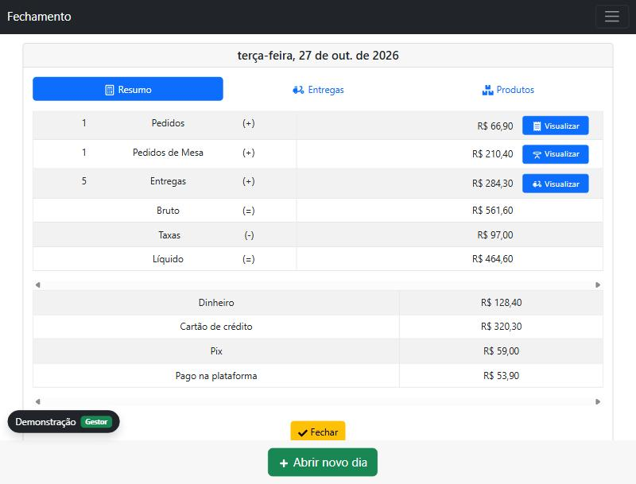
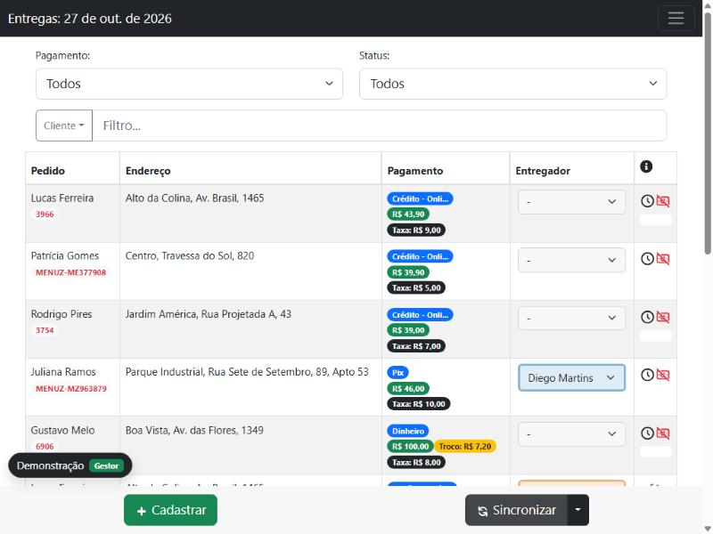
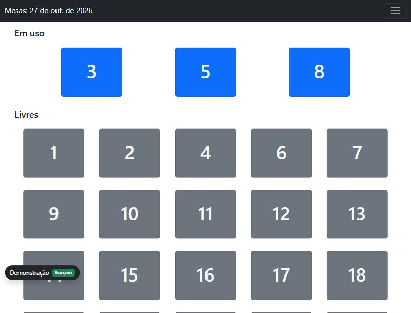
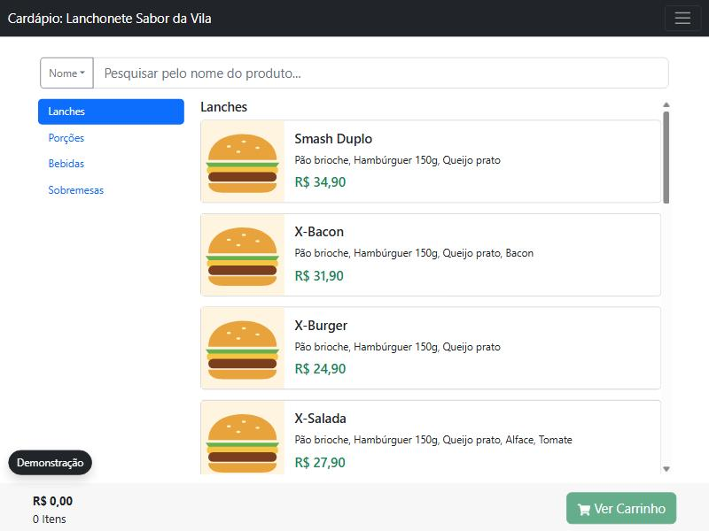
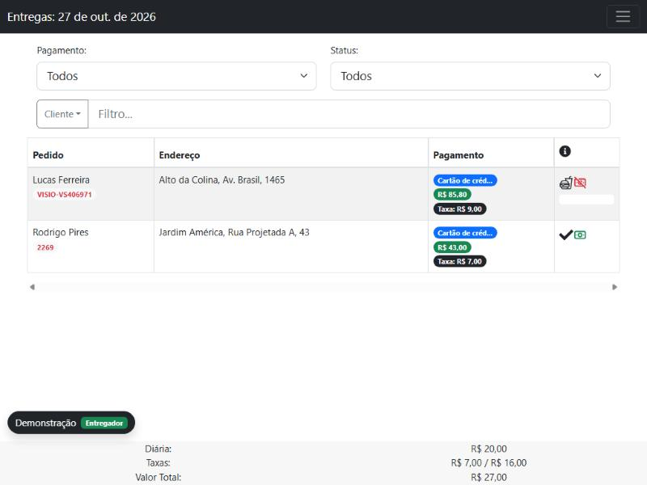

# Frota · Hub de delivery para restaurantes e lanchonetes

> **Demonstração ao vivo:** https://viniciusbertold.github.io/frota-demo/
>
> Este repositório é uma **vitrine** do sistema. Ele contém apenas a versão compilada
> do front-end rodando com dados fictícios. O código-fonte é privado.

Frota centraliza a operação de um restaurante em um só lugar: os pedidos que chegam das
plataformas de delivery, as entregas e os entregadores, o atendimento de mesas, o cardápio
digital e o fechamento do caixa do dia.



## O que dá para ver na demonstração

A demo abre com um painel **"Modo demonstração"** no canto inferior esquerdo. Escolha um perfil
e o sistema entra já logado, com uma lanchonete fictícia e 7 dias de movimento:

| Perfil | O que ele vê |
|---|---|
| **Gestor** | Fechamento do dia, pedidos, entregas de todos os entregadores, mapa de mesas, cardápio, produtos, formas de pagamento, usuários, integrações e parâmetros. |
| **Garçom** | Mapa de mesas: abre a mesa, lança pedidos pelo cardápio, acompanha a produção e fecha a conta. |
| **Entregador** | Somente as entregas atribuídas a ele e o ranking do dia. |
| **Cardápio público** | A visão do cliente: monta o pedido para retirada, entrega ou mesa. |

Tudo é interativo: dá para criar pedidos, atribuir entregador, finalizar entregas em lote,
registrar pagamentos, fechar contas de mesa e fechar o dia. As alterações ficam salvas só no
seu navegador (`localStorage`) e o botão **Restaurar dados** volta ao estado inicial.

A sincronização com as plataformas é simulada: de tempos em tempos "chegam" novos pedidos do
iFood, MenuZap e PlusDelivery na lista de entregas.

## Funcionalidades

- **Integrações de delivery:** importa pedidos do iFood, MenuZap e PlusDelivery e recebe pedidos
  de parceiros por API, unificando tudo em uma lista de entregas com o número do pedido de origem.
- **Entregas e entregadores:** atribuição de cada entrega a um entregador, acompanhamento por
  status (pendente, preparação, em andamento, finalizada, cancelada), finalização em lote e
  cálculo das taxas a pagar a cada entregador.
- **Mesas:** mapa de mesas, pedidos por mesa, produção, conta e pagamento com várias formas.
- **Cardápio digital:** categorias, produtos com variações (ex.: lata / 600ml / 2L),
  adicionais, composição de ingredientes e controle de estoque.
- **Cardápio público:** o cliente faz o pedido pelo celular, para a mesa ou para entrega.
- **Fechamento do dia:** totais de entregas, mesas e balcão, valores por forma de pagamento,
  itens vendidos e o histórico dos dias anteriores.
- **Impressão de comandas** em impressoras térmicas (ESC/POS) pela rede, USB ou Bluetooth.
- **PWA** instalável e um aplicativo **desktop** (Electron) com alertas sonoros de novos pedidos.
- **Multiempresa:** uma única instalação atende várias empresas, com isolamento dos dados por empresa.

## Tecnologias

| Camada | Stack |
|---|---|
| Front-end | React 18, TypeScript, React Router 6, React Query, React Bootstrap, Formik + Yup, React Table, SCSS Modules, PWA (Workbox) |
| Back-end | Node.js, Express, TypeORM, PostgreSQL, JWT, integrações REST com as plataformas de delivery |
| Desktop | Electron (impressão nativa, bandeja do sistema, alertas em segundo plano) |
| Impressão | Encoder ESC/POS próprio, QZ Tray e RawBT |

## Arquitetura (resumo)

```
 iFood · MenuZap · PlusDelivery          parceiros (API com token)
              │                                     │
              ▼                                     ▼
        ┌───────────────────────── API REST (Node + Express) ─────────────────────────┐
        │  autenticação JWT · perfis (gestor / garçom / entregador) · escopo por empresa │
        │  motor de importação · pedidos · entregas · mesas · cardápio · fechamento     │
        └──────────────────────────────────────┬────────────────────────────────────────┘
                                               │ PostgreSQL
              ┌────────────────────────────────┼─────────────────────────────┐
              ▼                                ▼                             ▼
     Web app / PWA (React)           App desktop (Electron)        Cardápio público
```

No front-end cada módulo segue o mesmo desenho: **Model → Controller (React Query) → Hook
composto → Páginas**, com um único ponto de acesso à API.

## Sobre esta demonstração

A versão publicada aqui é o mesmo front-end do produto, compilado sem source maps. A única
diferença é a camada de acesso à API: em vez de chamar o servidor, ela responde a partir de um
banco de dados fictício guardado no navegador. Nenhum dado real é usado ou enviado.

## Telas

| | |
|---|---|
|  |  |
|  |  |

---

Desenvolvido por **Vinicius Bertoldi**.
